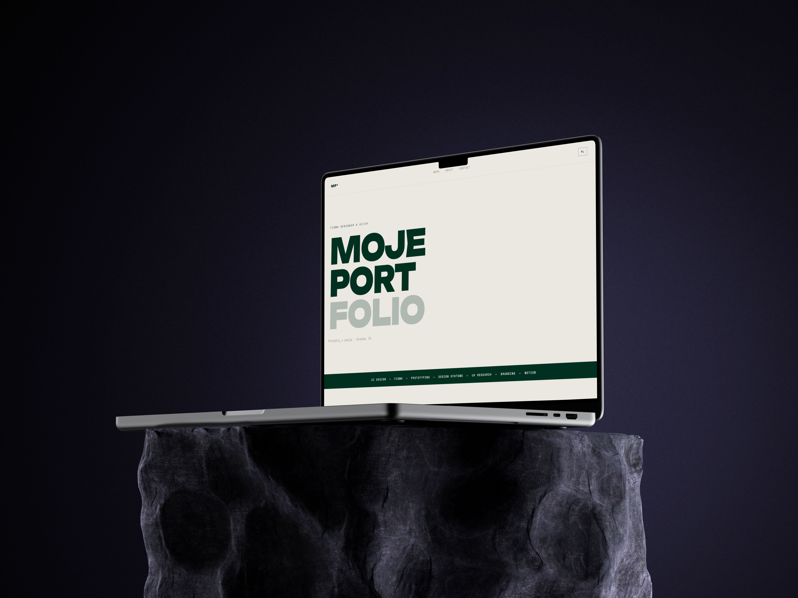

# Portfolio

Osobiste portfolio — grafika, web design i front-end. Statyczna strona napisana w HTML, CSS i JavaScript, zaprojektowana w Figmie.



## Funkcje

- Nagłówek z efektem rozpraszania pikseli (canvas)
- Przełącznik języka PL / EN (wybór jest zapamiętywany)
- Lista projektów z filtrami kategorii i podstrony projektów
- Formularz kontaktowy w oknie modalnym (wysyłka na e-mail przez Formspree)
- Responsywny układ

## Technologie

HTML5 · CSS3 · JavaScript (vanilla) · Figma

## Struktura

```
.
├── index.html            strona główna
├── projects.html         lista projektów
├── project.html          szablon podstrony projektu (project.html?id=1)
└── assets/
    ├── css/style.css
    ├── js/
    │   ├── main.js       strona główna
    │   ├── projects.js   lista projektów
    │   └── project.js    dane projektów i podstrona projektu
    └── img/
        └── projekt-N/    cover.jpg oraz 1.jpg ... 4.jpg
```

## Uruchomienie lokalnie

Otwórz `index.html` w przeglądarce. Formularz kontaktowy zadziała dopiero po wpisaniu własnego identyfikatora Formspree i opublikowaniu strony.

## Formularz kontaktowy

W `index.html` zamień `TWOJ_ID` w adresie `https://formspree.io/f/TWOJ_ID` na identyfikator z [formspree.io](https://formspree.io).

## Dodawanie projektu

1. Wrzuć zdjęcia do `assets/img/projekt-N/` (`cover.jpg` oraz opcjonalnie `1.jpg`–`4.jpg`).
2. Dodaj wpis do tablicy `PROJECTS` w `assets/js/project.js` (teksty po polsku i angielsku).
3. Skopiuj kartę projektu w `projects.html` i zmień numer, nazwę i opis (oraz klucze tłumaczeń w `assets/js/projects.js`).

## Publikacja

Strona jest statyczna, więc najprościej opublikować ją przez GitHub Pages: *Settings → Pages → Branch: main → / (root)*.

## Projekt w Figmie

_Dodaj tutaj link do pliku z projektem._

## Autor

Max — Bielsko-Biała, Polska
